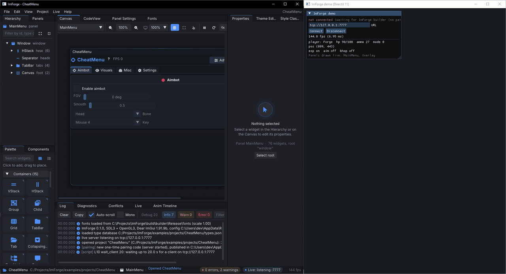
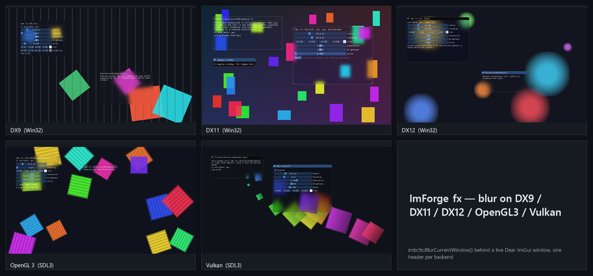

# ImForge

ImForge is a visual UI builder for (Dear ImGui)[https://github.com/ocornut/imgui]. You lay out a panel in the editor and, while
you do, the same panel is drawn inside your running application, with your renderer, your
fonts and your actual data. When you're happy with it you export plain `ImGui::` code, which
you can keep editing by hand and still reopen in the builder later.

The editor is an ImGui app itself, so the canvas shows what ImGui will really draw.

<p align="center">
  
</p>

## What it does

You drag widgets and containers into a tree, set their properties, and bind them to your
own variables. The builder reads your struct layouts from `compile_commands.json` (through
libclang) or from a one-line `IMFORGE_REFLECT` macro, so `cfg.aim.fov` autocompletes and a
checkbox bound to a `float` gets flagged before you compile anything.

Export gives you ordinary ImGui calls in your naming style. Your own code goes into marked
regions and survives re-exports. Small edits to generated lines (a label, a size, a flag)
are read back into the project, and anything the parser can't make sense of shows up as a
conflict where you pick "keep my code" or "regenerate".

Beyond the stock widgets there are layout containers (stacks, grids, `fill` and `%` sizes,
anchors), components with parameters and slots, themes and style classes, icon fonts, DPI
scaling, hover and press transitions, enter/exit animations, DrawList effects, and a shader
blur behind windows that works on DX9, DX11, DX12, OpenGL 3 and Vulkan:

<p align="center">
  
</p>
<p align="center"><sub>The <code>examples/fx</code> blur demos on all five backends, raw captures (see <a href="docs/media/README.md">docs/media</a>).</sub></p>

## Quick start

You need CMake 3.21+ and a C++17 compiler. Dear ImGui, SDL3 and the rest are fetched on the
first configure.

```sh
git clone https://github.com/fezura/ImForge
cd ImForge
cmake --preset wsl-gcc        # or: cmake --preset windows-msvc
cmake --build --preset wsl-gcc
./build/wsl-gcc/builder/imforge_builder
```

On Windows, build with `cmake --build --preset windows-msvc-release` and run
`build\windows-msvc\builder\Release\imforge_builder.exe`.

Then add the client to a development build of your app:

```cpp
#define IMFORGE_LIVE                      // remove for release: everything compiles to nothing
#include "imforge/imforge_client.h"

IMFORGE_REFLECT(Player, health, ammo, pos, name);
IMFORGE_REFLECT(Settings, esp, aimbot, fov);

// once, after ImGui::CreateContext()
imforge::live::Connect("tcp://127.0.0.1:7777");   // or "pipe://ImForge", "shm://ImForge"

// every frame, after ImGui::NewFrame()
imforge::live::NewFrame();
imforge::live::Draw("MainMenu", { imforge::live::Bind("player", player),
                                  imforge::live::Bind("cfg", settings) });
```

Press Start in the builder's Live panel and run the app. When the panel looks right, press
Ctrl+E to export `generated/MainMenu.h/.cpp`, replace the `Draw` call with
`ui::DrawMainMenu(state, player, settings)`, drop the `IMFORGE_LIVE` define and ship.

The [user guide](docs/USER_GUIDE.md) goes through all of this in more detail, and there are two
tutorials: a [cheat/mod menu](docs/TUTORIAL_CHEAT_MENU.md) and a
[dockable tool inspector](docs/TUTORIAL_TOOL_INSPECTOR.md).

## How live attach works

The builder runs a small server (TCP by default, a named pipe or shared memory if you
prefer) and your app connects to it. Pairing is automatic: when the builder starts listening
it writes a one-time code to a file only your user account can read, the app picks it up
before connecting, and from then on every message in both directions is authenticated. You
never type a code. For an app in a VM or running as another user there's a copy-the-code
fallback, described in [docs/LIVE_ATTACH.md](docs/LIVE_ATTACH.md).

In a dev build the client header contains a small interpreter. The builder sends the panel
definition as JSON and your app renders it, resolving bindings through the reflection
table. Handlers and locked code blocks are real C++, so they're compiled into your app and
need a rebuild when you change them; layout, properties, themes, bindings and no-code
actions don't. Without `IMFORGE_LIVE` all of this compiles away, and the exported code
depends on nothing but Dear ImGui (plus the small `imb_runtime.h` headers, copied next to the
exported code, if a panel uses animations or effects).

ImForge doesn't inject into anything or hook any API. Your app already draws ImGui; the
client just draws inside that frame.

## Compared to other ImGui builders

| | ImForge | ImRAD | ImStudio | Fellow ImGui |
|---|---|---|---|---|
| Runs as | desktop app | desktop app | desktop app, web demo | web app |
| Edits show up in your running app | yes | no | no | no |
| Reads edited code back | yes, marked regions | yes | no | no |
| Binds widgets to your variables | yes, type checked | yes | no | no |
| License | MIT | GPL-3.0 | MIT | MIT |

This is based on each project's README as of late 2026. If something here is wrong or out
of date, please open an issue.

## Supported versions

Dear ImGui 1.85 up to the current release, on both `master` and `docking`. Newer API is
gated by version, see [docs/VERSION_MATRIX.md](docs/VERSION_MATRIX.md). The builder runs on
Windows 10/11 and Linux; macOS isn't supported yet. Your app can use any platform and
renderer ImGui supports. Generated code targets C++14, 17 or 20. It's built and tested with
MSVC 2022 and GCC 13; other C++17 compilers should work but aren't in CI yet.

ImForge is at 0.1.0 and not released yet. There are no prebuilt binaries so far
([docs/RELEASING.md](docs/RELEASING.md) has the plan), and what comes next is in
[docs/ROADMAP.md](docs/ROADMAP.md).

## Docs

- [User guide](docs/USER_GUIDE.md) and [FAQ](docs/FAQ.md)
- [Live attach](docs/LIVE_ATTACH.md), [binding](docs/BINDING.md), [generated code and round-trip](docs/CODEGEN.md)
- [Components](docs/COMPONENTS.md), [custom widgets](docs/WIDGET_SDK.md), [animations and effects](docs/ANIMATIONS.md)
- [Architecture](docs/ARCHITECTURE.md), [spec](docs/SPEC.md), [design decisions](docs/DECISIONS.md)

## Contributing

Issues and pull requests are welcome. [CONTRIBUTING.md](CONTRIBUTING.md) covers the build,
the rules for the headers and what tests a change needs. Security problems go through
[SECURITY.md](SECURITY.md), not public issues.

## License

MIT, see [LICENSE](LICENSE). Dependencies and the fonts downloaded at configure time are
listed with their licenses in [THIRD_PARTY.md](THIRD_PARTY.md).
