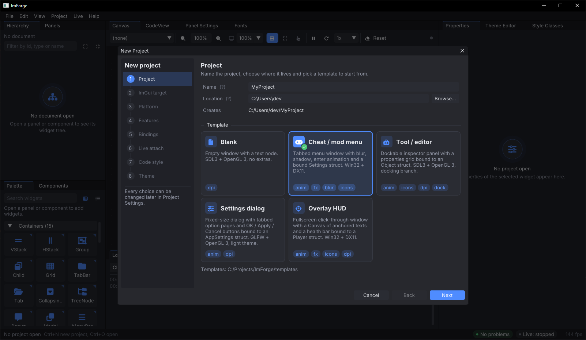
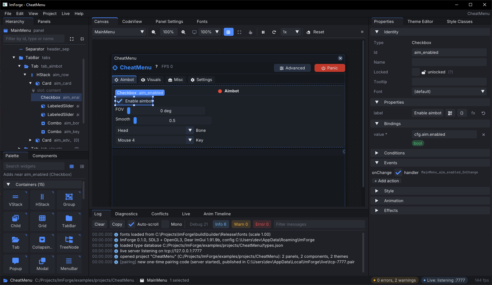

# ImForge user guide

This covers building ImForge, designing a panel, attaching it to your running app, exporting
the code and shipping it. File formats are in [SPEC.md](SPEC.md) and the reasons behind the
design are in [DECISIONS.md](DECISIONS.md).

- [Install and build](#install-and-build)
- [The new project wizard](#the-new-project-wizard)
- [The editor](#the-editor)
- [Building a panel](#building-a-panel)
- [Connecting your app](#connecting-your-app)
- [Export and round-trip](#export-and-round-trip)
- [Shipping](#shipping)
- [Keyboard shortcuts](#keyboard-shortcuts)
- [Glossary](#glossary)

## Install and build

You need CMake 3.21 or newer, a C++17 compiler (MSVC 2019+, GCC 9+, Clang 10+) and git.
CMake downloads Dear ImGui, SDL3, doctest, miniz and the fonts on the first configure.
LLVM/libclang is optional and only used by `imforge-reflect`; the Vulkan SDK is only needed
for the Vulkan example.

Linux / WSL:

```sh
git clone https://github.com/fezura/ImForge
cd ImForge
cmake --preset wsl-gcc
cmake --build --preset wsl-gcc
ctest --preset wsl-gcc                 # optional
./build/wsl-gcc/builder/imforge_builder
```

The builder window needs SDL3 with OpenGL 3. On a WSL distribution without the X11 (or
Wayland) and GL development packages you can still build the headers and the tests, but not
`imforge_builder`. Install `libx11-dev libgl-dev` or your distro's equivalent, or build the
editor on Windows.

Windows:

```powershell
git clone https://github.com/fezura/ImForge
cd ImForge
cmake --preset windows-msvc
cmake --build --preset windows-msvc-release
.\build\windows-msvc\builder\Release\imforge_builder.exe
```

| Preset | Generator | Notes |
|---|---|---|
| `wsl-gcc` | Ninja, Debug | Linux and WSL; only offered when the host is Linux |
| `wsl-gcc-release` | Ninja, Release | same, optimized |
| `windows-msvc` | Visual Studio 17 2022, x64 | multi-config; build preset `windows-msvc` is Debug, `windows-msvc-release` is Release |
| `windows-msvc-ninja`, `windows-msvc-ninja-release` | Ninja + `cl` | run from a `vcvars64` shell |

Every preset exports `compile_commands.json`, enables the tests and builds into
`build/<preset>/`. The options you're most likely to touch:

| Option | Default | Effect |
|---|---|---|
| `IMFORGE_BUILD_EXAMPLES` | OFF | builds the sample host apps (`imforge_example_dx11_win32`, `..._gl3_sdl3`, ...) and the blur demos |
| `IMFORGE_BUILD_TESTS` | ON | doctest executables, one per module |
| `IMFORGE_WITH_LIBCLANG` | AUTO | libclang scanner inside `imforge-reflect` and the builder |
| `IMFORGE_IMGUI_TAG` | `v1.91.9b-docking` | Dear ImGui tag the builder and examples are compiled against |
| `IMFORGE_BUILDER_BACKEND` | `SDL3_GL3` | `WIN32_DX11` builds the builder on Win32 + DirectX 11 instead |
| `IMFORGE_WITH_FX` | ON | shader blur backends |

Pass them on the configure line, e.g. `cmake --preset windows-msvc -DIMFORGE_BUILD_EXAMPLES=ON`.

The builder's command line is
`imforge_builder [project_dir] [--no-wizard] [--fonts <dir>] [--log <file>] [--script <file>] [--version] [--help]`.
Give it a folder that contains `imforge.json` and it opens that project; without one it
reopens the last project if that's turned on in the preferences. `--log` mirrors the Log
panel to a file, and `--script` runs an automation script (see `tools/demo/live_demo.txt`)
and exits with its result.

## The new project wizard



On first launch there's no project, so the New Project wizard opens by itself. Later you get
it from File > New Project... (Ctrl+N) or the New project... button in Project Settings. The
eight steps are listed on the left; a step turns green once you've visited it and it's
valid, orange if something needs fixing. Next and Back move between steps (Enter also
advances), Finish creates the project, Escape cancels. All of it can be changed later in
Project Settings.

- Project: the name (a C++ identifier, also used for the folder and the default namespace),
  the location, and a template card: Blank, Cheat / mod menu, Tool / editor, Settings dialog
  or Overlay HUD. Cards show feature badges (`anim`, `fx`, `blur`, `icons`, `dpi`, `dock`).
- ImGui target: version (1.85 to 1.93, or Custom) and branch (`master` or `docking`).
  Detect reads `IMGUI_VERSION_NUM` and `IMGUI_HAS_DOCK` from an `imgui.h` you point it at,
  and a table shows what the target supports and what falls back.
- Platform: window backend (Win32, SDL2, SDL3, GLFW) and renderer (DX9, DX11, DX12,
  OpenGL 3, Vulkan). Pairs that don't work are greyed out. The step also names the
  shader-fx header for your renderer.
- Features: animations, DrawList effects, shader effects (needs an fx backend), icon fonts,
  DPI scaling and docking (needs the docking branch). Below that are the component libraries
  found in `dist/*.imblib` and `packs/*/manifest.json` next to the builder, with checkboxes
  to import them and a Rescan button.
- Bindings: `compile_commands.json`, include paths, the structs to reflect and where
  `types.json` goes. Tick Skip for now to leave bindings empty.
- Live attach: on or off, the transport (TCP, named pipe, shared memory), port or name, the
  resulting URL, and a client snippet with a Copy button.
- Code style: C++ standard, namespace, header+source or single header, function and variable
  case, indent, DPI mode (`none`, `fontSize`, `variable`) with a base font size,
  `std::string` bindings, markers, runtime header name and output directory. Turning markers
  off also turns off round-trip.
- Theme: keep the template's theme, pick a preset, or paste an `ImGuiStyle` setup function
  under Import from code... and press Parse. The preview follows along.

Finish creates the folder from the template, imports the libraries you ticked, adds the
theme and saves. A project on disk is a folder of small JSON files: `imforge.json`,
`panels/<Name>.imb.json`, `components/<Name>.imc.json`, `themes/<Name>.theme.json`, and
optionally `types.json`, `fonts/` and `libs/`. They diff and merge well in git, and
`tools/validate_json.py` checks them against `schemas/`.

Builder preferences (recent projects, window size, editor theme, UI scale, the live bind
host, wizard or last project on startup) are stored in your per-user config directory. The
Log prints the path at startup.

## The editor



### Menus and status bar

Most menu entries are what you'd expect. A few worth knowing: Edit > History jumps to any
undo step, and Copy puts the selected nodes on the clipboard as JSON
(`"kind": "imforge-nodes"`), so you can paste them into another project or a text editor.
View has Reset Layout, UI Scale (75 % to 200 %) and a Dark or Light editor theme. Project >
Panels switches the active panel and has New Panel..., Manage Panels... and Panel
Settings.... The Live menu starts and stops the server, pushes (F5, Shift+F5) and toggles
picker mode (Ctrl+Shift+P). Help > Keyboard Shortcuts prints the list into the Log.

The status bar shows the project (with `*` when there are unsaved changes), the active
document and the selection count. On the right are a diagnostics counter and the live state,
both clickable, and the builder's frame rate.

### Window layout

By default Hierarchy and Panels sit top left with Palette and Components below them; Canvas,
CodeView, Project Settings, Panel Settings and Fonts share the center; Properties, Theme
Editor and Style Classes are on the right; Anim Timeline, Live, Log, Diagnostics and
Conflicts are along the bottom. They're normal docking windows, so move them around, close
them, bring them back from View, and use View > Reset Layout when you want the defaults back.

### The panels

Hierarchy is the node tree of the active panel or component. Click, Ctrl+click and
Shift+click select, F2 or a double-click renames the id, and the filter box matches id, type,
name or component. Drag rows to reorder or reparent them (a line means before/after, a frame
means into, red means not allowed), or drop Palette items on them. Locked nodes show a lock
badge and nodes hidden in the editor an eye. The right-click menu has Add child, Add sibling,
Wrap in, Unwrap, Duplicate, Delete, Rename id, Lock, Hide in editor, Convert to
component..., Expand all and Collapse all.

Palette lists every widget your ImGui target supports, by category, with Essentials and
Components at the end when you have them. Click an item to insert it next to the selection,
or drag it onto the Canvas or Hierarchy. The tooltip mentions the fallback when a widget
needs a newer ImGui than you target.

Panels lists the project's panels with + New, Duplicate, Rename, Delete and reorder buttons.
A deleted panel stays under "Deleted (until saved)" with a Restore button until you save.

Panel Settings holds the active panel's inputs: Parameters (the C++ objects it binds to,
added with + Add parameter), State (UI-only variables, + Add state variable with name, type
and default), the Generated signature with a Copy button, and Usage, which shows where each
one is referenced. Renaming a parameter or state variable updates every reference.

Canvas draws the active document with the same interpreter the live client uses, in a frame
the size of the window's `initialSize`. The toolbar switches documents (Params edits mock
parameter values for a component), zooms (Fit, presets, Ctrl+wheel), previews DPI from 100 %
to 200 %, and toggles Grid, Bounds and Interactive (clicks go to the widgets instead of
selecting). It also plays and replays animations and has Reset state, which clears panel
state, mock bindings and open popups. Bound widgets run on mock values, so sliders still
move. Blur shows as a placeholder because there's no scene behind the window here.

Properties edits the selected node in sections: Identity, Properties (the catalog props
such as `label`, `min`, `max`, `format`, `flags`, `size`), Bindings, Conditions, Events,
Style, Animation, Effects and Layout (anchor and offset inside a `Canvas`). The `fx` button
next to a value turns it into an expression and `default` resets it. Path and expression
fields are type checked while you type, with completion for `state.` and parameter paths.
Component instances get a Component instance section with parameter values and Unpack
instead. With several nodes selected, Style, Animation and Effects edits apply to all of
them.

CodeView shows the generated files, one tab per file, regenerated 250 ms after each edit
(untick Auto and use Regenerate if you'd rather not). Selecting a node highlights its
`@imb:begin` block and clicking a block selects the node. The toolbar switches split or
single header, toggles markers, copies the file or the selected block and opens Export....
Ctrl+F finds.

Theme Editor holds the project's themes: New (from ImGui Dark, Light, Classic or empty),
Duplicate, Rename, Delete, Import... and Export. Import takes a pasted C++ style function and
understands `style.Colors[ImGuiCol_X] = ...`, `PushStyleColor`, `ImColor`, `IM_COL32`,
`StyleColorsDark()` and the like; Export copies the theme to the clipboard as C++. Colors the
target ImGui doesn't have are marked, and Apply to editor preview makes the Canvas use the
active theme.

Style Classes are named sets of color and style-var overrides (`danger`, `accent`, `muted`
in the samples) that nodes pick up under `style.classes`. Renaming one updates every node
that uses it.

Fonts lists the project's fonts with Add font, Reload fonts, glyph ranges, Merge icons
(merges Font Awesome 6 so `{icon:fa-xxx}` tokens render) and a preview. A font a node uses
(`font: "Bold"`) has to exist here, and the generated `imforge_fonts.h` loads the same list
in your app.

Components holds your definitions and imported libraries. New... makes an empty one,
From selection... turns the selected nodes into a component and leaves an instance behind,
and Import... / Export... handle `.imblib` files. Selecting a component shows its parameters,
slots (with Insert Slot node) and instances; Edit opens its tree in the Canvas until you
press Done editing.

Anim Timeline works on the selected node. Play, Stop, Replay, Loop and a scrub slider drive
the preview, Force buttons pin a trigger (hover, active, open, ...) on or off, and quick-add
buttons create common setups: Hover color fade, Press scale, Enter FadeSlideUp, Rainbow
border, Soft shadow. Drag the right edge of a row to change its duration.

Conflicts shows the round-trip results of the last export or of Import hand-edited
file...: your code next to the generated code, with Keep my code (lock node) and Regenerate
per conflict, Apply all buttons, and a report of which nodes picked up literal edits.

Diagnostics lists validation problems (unknown paths, type mismatches, missing components,
duplicate ids, codegen and interpreter errors). Click a row to jump to the node.

Log shows builder and client messages with level and text filters.

Project Settings has the wizard's pages as tabs, plus Client snippet with Copy client code
and Copy CMake. Live is covered in [Connecting your app](#connecting-your-app).

## Building a panel

This walks through the pieces in the order you usually need them. The
[cheat menu tutorial](TUTORIAL_CHEAT_MENU.md) and the
[tool inspector tutorial](TUTORIAL_TOOL_INSPECTOR.md) do the same with real projects.

### Windows

A panel is one top-level `Window` plus its tree. A new project gets one panel from the
template; Project > Panels > New Panel... adds more. Select the root in Hierarchy to set the
title, flags (`NoCollapse`, `NoResize`, `NoTitleBar`, ...), `initialSize`, `initialPos`,
`sizeCond` and `menuBar`. The window's `open` slot is usually bound to `state.open`, which
gives the generated draw function a close box. Parameters (`cfg: Settings`) and state
variables are declared in Panel Settings and end up in the generated signature and the
`<Panel>State` struct.

### Layout

Containers come from the Palette: `VStack` (the default flow), `HStack` (children on one
line; `fill` widths share what's left), `Group`, `Child` (a scrollable region), `Grid` (a
table; children fill cells row by row, `columnWidths` takes pixel values and `fill`),
`CollapsingHeader`, `TreeNode`, `TabBar` with `Tab` children, `Popup`/`Modal`, `MenuBar` >
`Menu` > `MenuItem`, and `Canvas` for anchored placement (`layout.anchor` plus `offset`).
Sizes are `auto`, a pixel number (DPI-scaled), `fill`, `50%` or `fill-20`. To wrap existing
nodes, use Wrap in from the Hierarchy menu. A `Dummy` with `w: fill` makes a spacer.

For tabs, drop a `TabBar` and put `Tab`s inside it (the Hierarchy only accepts `Tab` under
`TabBar`). Setting `TabBar.anim.crossfade` cross-fades the tab content. Cards can be a
`Child` with a border and padding, the sample `Card` component (a title row and a `content`
slot), or the essentials pack's `SectionCard`.

### Widgets

All the stock widgets (listed in [SPEC.md](SPEC.md)) are in the Palette: `Checkbox`, `RadioButton`, `Combo`,
`ListBox`, `SliderFloat`/`SliderInt` (`components` 2 to 4 picks the vector variants),
`VSliderFloat`, `DragFloat`/`DragInt`, `InputText`/`InputTextMultiline`, `InputInt`,
`InputFloat`, `ColorEdit`/`ColorPicker`/`ColorButton`, `ProgressBar`, `Image`,
`ImageButton`, `Selectable`, `MenuItem`, `PlotLines`/`PlotHistogram`, plus `Text`,
`SeparatorText`, `Separator`, `Spacing`, `NewLine`, `Dummy`, `Button`, `SmallButton` and
`ArrowButton`. Labels can interpolate values and icons: `"HP: {player.health:%.0f}"`,
`"{icon:fa-play} Play"`. Flags come from version-gated lists, so a flag your target ImGui
doesn't have is left out.

### Binding to your variables

A binding connects a widget slot (`value`, `open`, `selected`, `texture`, `values`) to a
path over the panel's parameters or state: `cfg.esp.enabled`, `player.items[2].name`,
`state.selectedTab`. The builder learns your struct layouts from `types.json`, which
`imforge-reflect` writes from your `compile_commands.json` (or you write by hand), and uses
it for completion and type checking. A `SliderFloat` accepts `float`, `float[N]`, `ImVec2`
and `ImVec4`; a `Checkbox` wants a `bool`; a `Combo` bound to an enum takes its item names
from reflection. Unbound slots get mock storage so the canvas stays interactive. In the app,
the same table is declared with macros:

```cpp
IMFORGE_REFLECT(Player, health, ammo, pos, name);
IMFORGE_REFLECT(Settings, esp, aimbot, fov);
```

Supported member types and what each one generates are in [BINDING.md](BINDING.md).

### Conditions and state

`visibleIf` and `enabledIf` take expressions over the same paths
(`state.showAdvanced && cfg.esp.enabled`, `player.mode == Mode::Rage`,
`player.health > 0`). `visibleIf` turns into an `if`, `enabledIf` into
`BeginDisabled`/`EndDisabled`. State variables (`bool`, `int`, `float`, `double`, `string`,
`vec2`, `vec4`, `color`) hold UI-only values like the selected tab, a filter string or a
status message. They become fields of `<Panel>State`, named in the project's variable case
(`showAdvanced` becomes `show_advanced` with `snake`).

### Actions and handlers

Each widget event (`onClick`, `onChange`, `onEnter`, `onOpen`, `onClose`) can run no-code
actions, call a handler, or both:

| Action | Effect |
|---|---|
| `set` | assign a literal or expression to a path |
| `toggle` | flip a bool |
| `openPopup` / `closePopup` | open the `Popup`/`Modal` with the given id / close the current one |
| `setTab` | select a `Tab` in a `TabBar` next frame |
| `copyClipboard` | `ImGui::SetClipboardText` with a (possibly interpolated) string |
| `handler` | call the generated handler function |

A handler is a function the generator declares for you,
`static void <Panel>_<id>_<Event>(<Panel>State&, params...)`, with an empty `@imb:user` body
that survives re-exports. Actions run first, then the handler. The live interpreter can't
run C++, so in dev builds the handler is compiled into your app and registered;
`generated/imforge_dev.h` does that for you (see [Handlers, blocks and custom widgets](#handlers-blocks-and-custom-widgets)).

### Style and themes

Per-node overrides live under Style: `colors` (`Button`, `Text`, ...) and `vars`
(`FrameRounding`, `FramePadding`, ...) become matched push/pop pairs, and `classes` refer to
Style Classes, which become `Style_<class>_Push()/Pop()` helpers. A theme is a complete
`ImGuiStyle` table, edited in the Theme Editor and exported as
`ApplyTheme_<Name>(ImGuiStyle&)`. The active theme is what the Canvas and the live app draw
with. Fonts set per node (`font: "Bold"`) must be in the Fonts panel.

### Animations and effects

Transitions animate `color.<ImGuiCol>`, `alpha`, `offset.x/y`, `scale`, `rounding`, `border`
or `size.w/h` on `hover`, `active`, `open`, `visible` or `disabled`, with a duration and an
easing (`OutCubic`, `OutBack`, `OutElastic`, ...) or a spring with stiffness and damping.
Enter and exit presets (`Fade`, `SlideUp`, `FadeSlideUp`, `ScalePop`, `Stagger`, ...) play
when a node appears or its `visibleIf` turns false, and `stagger` delays children one after
another. Effects are listed per node: DrawList effects (`gradient`, `radialGradient`,
`shadow`, `glow`, `border` with `Solid`/`Rainbow`/`Sweep`/`Pulse`, `particles`, `noise`,
`cursorHighlight`) and the shader `blur`. The Anim Timeline lets you scrub and force
triggers. All of it is implemented in `imb_runtime.h`; see [ANIMATIONS.md](ANIMATIONS.md).

### Components

Select some nodes and use Convert to component... (Hierarchy) or From selection...
(Components), or start an empty one with New.... Inside a definition any prop or binding can
be `{"param": "name"}`, and `Slot` nodes mark where an instance's children go. An instance
is a `Component` node with parameter values, and you edit its slot children in place on the
canvas. Instances follow the definition; Unpack turns one back into plain nodes. In the
generated code a component is a function and an instance is a call wrapped in
`PushID(instance id)`. More in [COMPONENTS.md](COMPONENTS.md).

### Libraries and packs

An `.imblib` is a zip of components, widget manifests and headers. File > Import .imblib...
(or the wizard's Features step, or Import... in Components) copies it into `libs/` and adds
its widgets to the Palette; Export... in Components writes one from your components. The
essentials pack (`packs/essentials`) is kept as source plus manifests, and
`python tools/pack_imblib.py packs/essentials dist/essentials.imblib` packages it so the
wizard can offer it. Custom widgets are described by `.imw.json` manifests
([WIDGET_SDK.md](WIDGET_SDK.md)); the Canvas draws their `preview` shapes until a live app
renders the real thing.

## Connecting your app

### What the app needs

```cpp
#define IMFORGE_LIVE                      // development builds only
#include "imforge_client.h"               // or dist/imforge_client_single.h

IMFORGE_REFLECT(Player, health, ammo, pos, name);
IMFORGE_REFLECT(Settings, esp, aimbot, fov);

// once, after ImGui::CreateContext() and the backend init
imforge::live::Connect("tcp://127.0.0.1:7777");   // or "pipe://ImForge", "shm://ImForge"

// every frame, after ImGui::NewFrame()
imforge::live::NewFrame();
imforge::live::Draw("MainMenu", { imforge::live::Bind("player", player),
                                  imforge::live::Bind("cfg", settings) });
```

`Connect` never blocks and keeps retrying every second until the builder is listening.
`Draw` renders the latest version of the named panel; call it once per panel per frame.
`Bind` only compiles for reflected types. Without `IMFORGE_LIVE` every call is an empty
inline function, so the lines can stay in release builds. You don't have to type this:
Copy client snippet in the Live panel and Project Settings > Client snippet both generate it
with your panel name, parameter roots and URL, plus a CMake fragment.

### Pairing

There's nothing to set up. When the builder starts listening it writes a one-time code to a
pairing file only your user account can read, and the app reads it before connecting. Both
sides prove they know the code, and after that every message is authenticated. The Live
panel shows the pairing state, the file path, failed attempts, Rotate now and a Require
pairing switch (a builder preference, on by default). If the app can't read the file (VM,
another machine, another user), use Copy code and pass it with the `IMFORGE_PAIRING_CODE`
environment variable or `imforge::live::SetPairingCode()`. Details are in
[LIVE_ATTACH.md](LIVE_ATTACH.md).

### Transports

The builder is the server, and the URL you pass to `Connect` has to match Project Settings >
Live (or the transport row in the Live panel).

| Transport | URL | When |
|---|---|---|
| TCP | `tcp://127.0.0.1:7777` | default; works everywhere, also to another machine or VM once `liveBindHost` in the builder preferences is `0.0.0.0` |
| Named pipe / Unix socket | `pipe://ImForge` (`\\.\pipe\ImForge` on Windows, `/tmp/imforge-ImForge.sock` on Linux) | lowest overhead, local only |
| Shared memory | `shm://ImForge` | no sockets at all; a ring buffer polled every frame |

Start listening with Start in the Live panel, Live > Start Server, or automatically when the
project opens (Auto-start). The status line goes from `Listening on ...` to
`App connected on ..., pairing` and then `Client connected: <app> pid <n>, ImGui <version>,
<backend>/<platform>`. If you change the transport while listening, a Restart to apply
button shows up.

### The Live panel

Below the status and pairing rows, the transport row sets the transport and port or name,
Auto-start, shows the URL and has Copy client snippet. The sync row has Push all
(Shift+F5), Push panel (F5), the Auto-push toggle (changed panels are sent 150 ms after your
last edit), Pick in app (Ctrl+Shift+P) and traffic counters. Then there are tabs:

- Blocks & handlers: every `Code` node, locked node and handler, with its function name,
  whether the app registered it and whether it's stale.
- App log: messages the client sent.
- Panels: which panels the app draws.
- Troubleshooting: problems the builder detected, with explanations.
- Stats: frame rate history, message counts, and the widgets and textures the app registered.

### What updates live

Layout, properties, sizes, bindings, expressions, interpolation, state, no-code actions,
themes, style classes, fonts (when the app loads the project fonts), animations, effects and
blur parameters all update without recompiling. With Auto-push on they're sent 150 ms after
your last edit; otherwise press F5 for the active panel or Shift+F5 for everything. Handler
bodies, locked `Code` blocks and custom widget implementations are C++, so those need a
rebuild of the app.

### Handlers, blocks and custom widgets

Anything that is C++ is called from your binary:

```cpp
imforge::live::RegisterHandler("MainMenu.btn_play.onClick", &MainMenu_btn_play_OnClick_Live);
imforge::live::RegisterBlock("MainMenu.custom_1", &MainMenu_custom_1_Block_Live);
imforge::live::RegisterWidget("Toggle", &imb::ess::DrawToggleInterp);   // custom widgets
imforge::live::RegisterTexture("logo", my_texture_id);                  // Image widgets
```

The exported `generated/imforge_dev.h` already contains the handler and block registrations
for the whole project, so normally you `#include` it after `Connect` and don't write these
yourself. In the Blocks & handlers tab each entry is "not registered" (the app never called
`Register*` for it, so the panel draws a placeholder box), registered, "up to date", or
"stale: recompile" when the body in the builder no longer matches the hash the app was built
with. Right-click a row to copy the function name or the registration call.

### Picker mode

Press Pick in app in the Live panel, Live > Picker Mode, or Ctrl+Shift+P. Hovering a widget
in your app outlines it and highlights its Hierarchy row, and clicking selects the node in
the builder (the widget's own click is swallowed). The status bar shows `[picker]` while
it's on; press the shortcut again to leave.

### When it doesn't work

The Troubleshooting tab checks most of these for you.

- Nothing connects: the builder isn't listening (press Start), the URL or transport doesn't
  match, or Windows is waiting on a firewall prompt. The Log says `client connected on ...`
  as soon as the app reaches the builder.
- The app's status says `waiting for ImForge builder (no pairing file ...)` while the
  builder is listening: the app can't see the pairing file, usually because it runs in a VM
  or as another user. Use Copy code (see [Pairing](#pairing)).
- `Client paired on ... (waiting for its client_info)` never resolves: the app's ImGui
  version or build is incompatible. Check the app's stdout (`SetLogCallback`).
- A panel shows a placeholder box: a locked block or custom widget isn't registered (include
  `imforge_dev.h`, call `RegisterWidget`). The Panels tab tells you when the app draws a
  panel the project doesn't have, or never draws one it has.
- Bindings show mock values: the path doesn't resolve against the registered table. Check the
  `IMFORGE_REFLECT` field lists and the root names passed to `Draw`.
- `stale: recompile` badges: rebuild the app, or re-export if you changed the block in the
  builder.
- Fonts or icons look different from the canvas: the app draws with its own atlas, so load
  the project fonts with the generated `imforge_fonts.h`.
- No blur in the app: no `imb_fx_<backend>.h` is included or `PrepareFrame` isn't called; see
  [Shader blur](#shader-blur).

More in [LIVE_ATTACH.md](LIVE_ATTACH.md).

## Export and round-trip

### Export

Ctrl+E, File > Export Code... or Export... in CodeView opens the Export code dialog. It
shows the output folder (`codegen.outputDir`, default `generated/`, relative to the project),
a choice between header + source and single header, the markers switch, and the list of
files that will be written, each tagged new, update, same or "no marker". Export writes
`<Panel>.h/.cpp` per panel (or one header each with `splitHeader: false`),
`imforge_components.h/.cpp`, `imforge_theme_<Name>.h`, `imforge_styles.h`,
`imforge_fonts.h`, `imforge_reflect.h` and `imforge_dev.h`. The same project always gives
byte-identical files. The status bar then reports `Exported N file(s)` and the conflict
count, and the Conflicts panel opens if there are any.

Two things make export stop and ask. A file in the output folder without an `@imb:file`
marker wasn't written by ImForge, so you get an "Overwrite files without markers?" prompt
first. And if the output folder points outside the project folder (it came from the project
file), you have to allow that folder once before anything is written there.

The generated draw function takes the panel's parameters by reference, plus a state struct:

```cpp
void DrawMainMenu(MainMenuState& state, Player& player, Settings& cfg);
```

### Where you can edit

| Region | Marker | Rule |
|---|---|---|
| user slots | `// @imb:user id=S` ... `// @imb:end id=S` | always yours; slots exist for `includes`, `header_extra`, `file_top`, `before_draw`, `after_draw` and every handler body |
| locked blocks | `// @imb:locked id=X h=HASH` ... `// @imb:end id=X` | a `Code` node or a node you locked; kept verbatim, called from the tree |
| generated blocks | `// @imb:begin id=X h=HASH` ... `// @imb:end id=X` | regenerated; literal edits (strings, numbers, flag names) are read back into the node, anything else becomes a conflict |

Lock a node from the Hierarchy menu when you want to own its code completely. Everything
outside markers gets regenerated, and with markers off export is one-way.

### Conflicts

When you export over existing files, user slots and locked bodies are carried into the new
output. Every block whose hash changed is compared with the freshly generated one: if only
literals differ, they're written back into the project (the Conflicts report lists those as
"nodes updated from hand-edited literals"), and anything else is reported as a conflict.
For each one the panel shows your code next to the generated code. Keep my code (lock node)
turns the node into a locked block with your text as its body; Regenerate throws your edit
away. Nothing is overwritten until you choose. Import hand-edited file... does the same for a
generated file you edited outside the builder, without exporting. The rules and markers are
described in [CODEGEN.md](CODEGEN.md).

## Shipping

### Release build checklist

1. Export (Ctrl+E) and add the generated `.cpp` files to your build. Add the project's
   `generated/` directory and ImForge's `include/` to the include path.
2. Replace `imforge::live::Draw("MainMenu", {...})` with
   `ui::DrawMainMenu(main_menu_state, player, cfg);` and keep one state struct per window
   instance. Apply the theme and load fonts once: `ui::ApplyTheme_<Name>(ImGui::GetStyle())`,
   `ui::LoadFonts(ImGui::GetIO())`.
3. Remove `#define IMFORGE_LIVE`, or only define it for Debug. The `imforge::live::*` calls
   then compile to nothing, and you no longer need `imforge_dev.h` or the `IMFORGE_REFLECT`
   tables.
4. If the project uses `std::string` bindings, compile `misc/cpp/imgui_stdlib.cpp`.

The output never references `imforge::`. It depends on Dear ImGui and, if you use them, the
two headers below. Project Settings > Client snippet gives you a CMake fragment like this:

```cmake
target_include_directories(app PRIVATE "${IMFORGE_DIR}/include" "${IMFORGE_DIR}/packs/essentials" "path/to/project/generated")
target_compile_definitions(app PRIVATE $<$<CONFIG:Debug>:IMFORGE_LIVE> IMGUI_DEFINE_MATH_OPERATORS)
```

### `imb_runtime.h`

Panels with transitions, presets or DrawList effects include `imb_runtime.h`, a single
header that needs nothing but Dear ImGui (the name can be changed with
`codegen.runtimeHeader`). Panels without them stay plain ImGui. Animation state is keyed by
`ImGuiID` and dropped after two seconds of inactivity.

### Shader blur

Blur needs the rendered scene, so there's one implementation per renderer in
`include/imforge/fx/`. Include exactly one backend header in one translation unit. It
defines `IMB_FX_AVAILABLE`, and generated code only calls `imb::fx::Blur` when that's
defined, so without the header the same code compiles and just has no blur.

| Renderer | Header | `Init` | `PrepareFrame` goes |
|---|---|---|---|
| DX9 | `imb_fx_dx9.h` | `Dx9InitDesc{ device }` | inside `BeginScene`/`EndScene` after the scene; call `OnDeviceLost`/`OnDeviceReset` around `Reset()` |
| DX11 | `imb_fx_dx11.h` | `Dx11InitDesc{ device, context }` | after `ClearRenderTargetView`, with `FrameDesc::back_buffer_rtv` |
| DX12 | `imb_fx_dx12.h` | `Dx12InitDesc{ device, rtv_format, frames_in_flight, SRV heap + descriptor range }` (`frames_in_flight + 6` consecutive descriptors) | on the open command list with the back buffer in `RENDER_TARGET` state; ImGui must render on the same list |
| OpenGL 3 | `imb_fx_gl3.h` | `Gl3InitDesc{ loader, GLSL version }` | after `glClear`, with framebuffer, width and height |
| Vulkan | `imb_fx_vulkan.h` | `VulkanInitDesc{ instance, physical_device, device, queue_family, queue, descriptor_pool, render_pass, color_format, image_count }` | on the frame command buffer outside any render pass; the swapchain needs `VK_IMAGE_USAGE_TRANSFER_SRC_BIT` |

The frame looks the same everywhere:

```cpp
// render your scene
imb::fx::PrepareFrame(fd);                 // copies the back buffer, builds the blurred mip chain
ImGui::Render();
ImGui_ImplXXX_RenderDrawData(ImGui::GetDrawData());   // Blur() draw callbacks sample the capture
```

For DX11, from `examples/client/dx11_win32/main.cpp`:

```cpp
imb::fx::Dx11InitDesc d; d.device = g_pd3dDevice; d.context = g_pd3dDeviceContext;
imb::fx::Init(d);                          // once, after ImGui_ImplDX11_Init
...
imb::fx::FrameDesc fd; fd.back_buffer_rtv = g_mainRenderTargetView;
imb::fx::PrepareFrame(fd);                 // each frame, before ImGui::Render()
...
imb::fx::Shutdown();                       // at exit
```

The capture happens before ImGui draws, so the blur shows the scene behind the window, not
other ImGui windows. For a menu over a game that's what you want. Hand-written windows can
use the same capture: call `imb::fx::BlurCurrentWindow(radius, rounding)` right after
`ImGui::Begin()` (a negative rounding uses the style's `WindowRounding`).
`examples/README.md` lists where each example hooks in.

## Keyboard shortcuts

Global (ignored while you're typing in a text field):

| Shortcut | Action |
|---|---|
| Ctrl+N / Ctrl+O | New project (wizard) / Open project |
| Ctrl+S / Ctrl+Shift+S | Save / Save As |
| Ctrl+E | Export code |
| F5 / Shift+F5 | Push active panel / push everything to the live app |
| Ctrl+Shift+P | Toggle picker mode |
| Ctrl+Z / Ctrl+Y (Ctrl+Shift+Z) | Undo / Redo |
| Ctrl+X / Ctrl+C / Ctrl+V | Cut / Copy / Paste nodes (clipboard JSON) |
| Ctrl+D | Duplicate selection |
| Delete | Delete selection |
| Alt+F4 | Exit |

Hierarchy (when focused):

| Shortcut | Action |
|---|---|
| Up / Down, Shift+Up / Down | Move selection / extend it |
| Left / Right | Collapse (or go to parent) / expand (or go to first child) |
| Home / End | First / last row |
| Ctrl+Up / Ctrl+Down | Move the node among its siblings |
| F2, double-click | Rename id |
| Ctrl+A | Select all nodes |
| Ctrl+click, Shift+click | Toggle / range select |

Canvas (when focused):

| Shortcut | Action |
|---|---|
| Arrow keys, Shift+arrows | Nudge the selection (offset inside a `Canvas`, otherwise reorder) by a small / large step |
| Escape | Clear selection |
| Ctrl+mouse wheel | Zoom around the cursor |
| Ctrl+click | Add to selection |

Also: Ctrl+F opens the find bar in CodeView, Enter and Escape advance and cancel the wizard,
and you can click or drag the Anim Timeline ruler to scrub.

## Glossary

- Binding root: a named object passed to `imforge::live::Draw` with `Bind("name", obj)`.
  Paths start with the root name.
- Block: the code generated for one node, between `@imb:begin` and `@imb:end` markers and
  identified by a hash of its body.
- Code node: a node whose content is raw C++. Exported as a locked block, drawn as a
  placeholder in the Canvas, run through `RegisterBlock` in live mode.
- Design mode: how the Canvas renders. The interpreter draws the window inline, reports item
  rectangles, turns clicks into selection and uses mock values for bindings.
- DPI mode: how generated sizes scale: `none`, `fontSize` (`GetFontSize()/baseFontSize`) or
  `variable` (an `imb_scale` parameter).
- Mock value: storage the interpreter uses for an unbound slot or a path it can't resolve,
  so widgets stay interactive in the builder.
- SizeSpec: `auto`, a pixel number, `fill`, `N%` or `fill-N`.
- Stale: a locked block or `Code` node whose body in the builder no longer matches the hash
  the app was compiled with.
